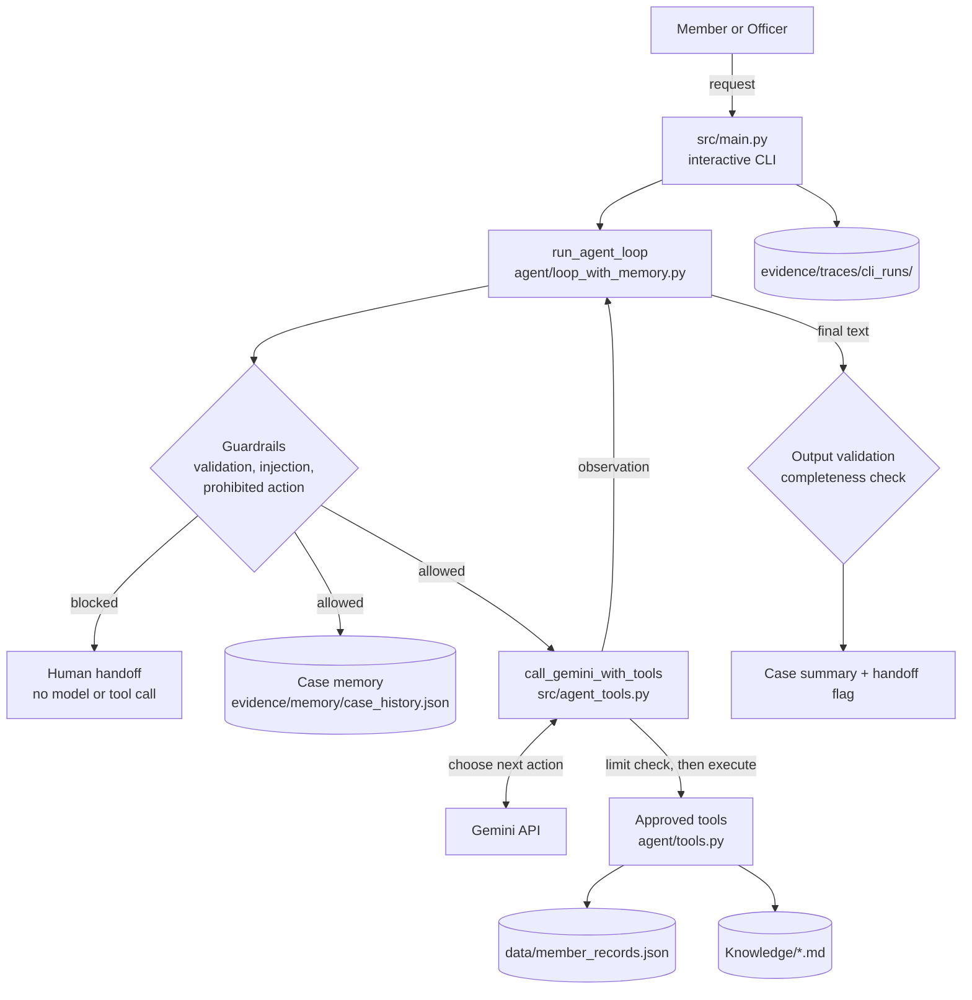

# SACCO Member-Case Preparation Agent

An AI-assisted, bounded agent that prepares SACCO loan cases for human review. It gathers a member's record, retrieves the relevant SACCO policy, calculates an illustrative repayment schedule, and drafts a structured case summary that lists what is satisfied, what is missing, and what still needs to be checked. A Relationship Officer then reviews that summary.

> **Decision support, not decision making.** The agent never approves, rejects, scores, or disburses loans, and never modifies member accounts. Every case it prepares ends with a human handoff.

Developed for **BSE4104 Emerging Trends in Software Engineering (AI-Native & Agentic Engineering Capstone)** at Makerere University. All member records and policy documents are synthetic.

---

## Contents

- [Problem and intended users](#problem-and-intended-users)
- [Key features](#key-features)
- [Architecture](#architecture)
- [Technology stack](#technology-stack)
- [Repository structure](#repository-structure)
- [Getting started](#getting-started)
- [Running the agent](#running-the-agent)
- [Example session](#example-session)
- [Tests and evaluation](#tests-and-evaluation)
- [Execution traces and evidence](#execution-traces-and-evidence)
- [Safety and authorization](#safety-and-authorization)
- [Known limitations](#known-limitations)
- [Troubleshooting](#troubleshooting)
- [Releases](#releases)
- [Project documentation](#project-documentation)

---

## Problem and intended users

Preparing a SACCO loan application means working across several loan products, interest rates, repayment rules, guarantor requirements, and supporting-document lists. That information is spread across policy documents and member records. Cases often reach a Relationship Officer incomplete, which leads to repeated back-and-forth.

This project brings the preparation steps into one bounded workflow:

| User | How they use the system |
|---|---|
| **SACCO member** (primary) | States the loan they want (product, amount, term, frequency) and receives a prepared case showing matching policy terms, an illustrative repayment schedule, and outstanding requirements. |
| **Relationship Officer** (secondary) | Receives the structured case and its execution trace, verifies the outstanding items, and makes every lending decision. |

The prepared case summary covers: the member's request, the matching loan product and its documented conditions, relevant member information, illustrative repayment figures, requirements (satisfied / missing / requires human verification), supporting documents, outstanding clarification questions, and an explicit *Human Review Required* section.

## Key features

- **Interactive CLI** ([src/main.py](src/main.py)): one session for submitting requests, watching each tool call live, reading the prepared case, and saving a trace for every run.
- **Bounded agent loop** ([src/agent/loop_with_memory.py](src/agent/loop_with_memory.py)): at most **6 iterations** per case and **2 calls per tool**, enforced in Python rather than by the prompt.
- **Three approved, read-only tools** ([src/agent/tools.py](src/agent/tools.py)): `get_member_record`, `retrieve_policy`, and `calculate_repayment`. No other tool can be executed.
- **Policy retrieval (RAG)**: the agent retrieves policy text from the Markdown knowledge base in [Knowledge/](Knowledge/) and uses it as grounding. A separate embedding-based RAG Q&A pipeline ([src/rag_chat.py](src/rag_chat.py)) answers policy questions with source citations.
- **Deterministic guardrails** ([src/agent/guardrails.py](src/agent/guardrails.py)): input validation, a pre-flight block on approval/rejection/disbursement/account-change requests, prompt-injection detection (in user input and in retrieved policy text), a tool allow-list, and output validation.
- **Persistent case memory** ([src/agent/memory.py](src/agent/memory.py), [src/agent/state.py](src/agent/state.py)): owner-only, schema-validated JSON memory that stores preparation progress, not raw records or decisions.
- **Observability** ([src/agent/observability.py](src/agent/observability.py)): run IDs, timing, structured events, and redaction of personal data in saved traces.
- **Evaluation harness** ([src/agent/evaluation.py](src/agent/evaluation.py)): 36 scenarios across six categories, run deterministically without API calls.

## Architecture



**How one request flows**

1. **Guardrails first.** `run_agent_loop` validates the input, scans it for prompt injection, and checks it for prohibited actions. A blocked request stops here, before any model or tool call, and is handed to a human.
2. **Sense → plan → act → observe.** Each iteration sends Gemini a compact view of the current state: the member-record summary, retrieved policy excerpts, the repayment summary, tool counts, and limits. Gemini picks one approved tool or returns its final text. [src/agent_tools.py](src/agent_tools.py) checks the per-tool limit *before* executing the tool and records whether the tool actually ran.
3. **Tools run in Python, not in the model.** Authorization (members can read only their own record), policy lookup, and repayment arithmetic are all deterministic Python code.
4. **Stop conditions.** The loop ends on a final response, a tool error, a blocked or unknown tool, injection found in retrieved policy, or the iteration limit. A response is labelled `case_complete` only if the member record, policy, and repayment schedule were all gathered. Otherwise an *incomplete case packet* is produced.
5. **Memory and trace.** Preparation progress is saved after each observation and at the end of the run. The full run trace is returned, and the CLI writes it to disk.

| Module | Responsibility |
|---|---|
| [src/main.py](src/main.py) | Interactive CLI; forwards requests to `run_agent_loop`, shows live progress, saves traces |
| [src/agent/loop_with_memory.py](src/agent/loop_with_memory.py) | Bounded agent loop with guardrails, memory, and trace generation (used by the CLI and the evaluation) |
| [src/agent/loop.py](src/agent/loop.py) | Week 5 bounded loop without memory (used by the Week 5 scenario runner) |
| [src/agent_tools.py](src/agent_tools.py) | Gemini function-calling round: tool declarations, per-tool limit check, tool execution |
| [src/agent/tools.py](src/agent/tools.py) | The three approved tools and loan-product terms |
| [src/agent/guardrails.py](src/agent/guardrails.py) | Input, prohibited-action, injection, allow-list, and output checks |
| [src/agent/state.py](src/agent/state.py) | Versioned workflow-state schema and validation |
| [src/agent/memory.py](src/agent/memory.py) | JSON case-memory store with owner/officer access rules and atomic writes |
| [src/agent/observability.py](src/agent/observability.py) | Tracer, PII masking, JSONL event writer |
| [src/agent/evaluation.py](src/agent/evaluation.py) | 36-scenario deterministic evaluation and metrics |
| [src/rag_chat.py](src/rag_chat.py), [src/rag/](src/rag/), [embeddings.py](embeddings.py) | Embedding-based RAG question answering over `Knowledge/` |
| [src/baseline_chat.py](src/baseline_chat.py) | System-prompt loader and Gemini baseline client |

## Technology stack

- **Python 3.10+** (developed and verified with Python 3.13; Windows and WSL/Ubuntu)
- **Google Gemini API** over REST: `generateContent` with function calling for the agent, and `embedContent` for RAG embeddings
- **requests** and **python-dotenv** (the only third-party dependencies, see [requirements.txt](requirements.txt))
- **unittest** from the standard library, for tests
- Local JSON and Markdown files for member records, the policy corpus, memory, and evidence. There is no database.

## Repository structure

```text
sacco-agent/
├── src/
│   ├── main.py                    # Interactive CLI (application entry point)
│   ├── agent_tools.py             # Gemini function calling + tool limit enforcement
│   ├── baseline_chat.py           # System-prompt loader, Week 2 baseline client
│   ├── rag_chat.py                # RAG question answering with citations
│   ├── run_rag_eval.py            # Week 3 RAG evaluation (live)
│   ├── run_eval.py                # Week 2 prompt evaluation (live)
│   ├── run_tools_tests.py         # Week 4 deterministic tool tests
│   ├── rag/retrieval.py           # Cosine-similarity top-k retrieval
│   └── agent/
│       ├── loop_with_memory.py    # Bounded agent loop + memory (main orchestrator)
│       ├── loop.py                # Week 5 bounded loop (no memory)
│       ├── tools.py               # Approved tools
│       ├── guardrails.py          # Deterministic guardrails
│       ├── state.py               # Workflow-state schema
│       ├── memory.py              # Persistent case memory
│       ├── observability.py       # Tracing and redaction
│       ├── evaluation.py          # 36-scenario evaluation harness
│       ├── run_agent_cases.py     # Week 5 scenario runner (fake model, real tools)
│       └── week6_memory_demo.py   # Memory save/restore/access-control demo
├── tests/                         # unittest suites
├── Knowledge/                     # 20 synthetic SACCO policy documents (Markdown)
├── data/
│   ├── member_records.json        # Synthetic member records
│   └── evaluation/scenarios.json  # 36 evaluation scenarios
├── prompts/                       # Versioned system prompts (v1.0, v1.1, v1.2)
├── embeddings.py                  # Chunking + Gemini embeddings for RAG
├── knowledge_index.json           # Cached embedding index for RAG
├── evidence/                      # Test results, traces, evaluation metrics
├── docs/                          # Requirements, architecture, evaluation, reports
├── .env.example                   # Environment-variable template
└── requirements.txt
```

## Getting started

### Prerequisites

- Python 3.10 or newer
- Git
- A Google AI Studio API key (free tier). This is needed only for **live** model runs: the CLI, RAG Q&A, and the RAG and prompt evaluations. The unit tests, the 36-scenario evaluation, the scenario runner, and the tool tests run without it.

### 1. Clone the repository

```bash
git clone https://github.com/KisomoseArnoldPatrick/sacco-agent.git
cd sacco-agent
```

### 2. Create and activate a virtual environment

```bash
# Linux / WSL / macOS
python3 -m venv venv
source venv/bin/activate
```

```powershell
# Windows PowerShell
python -m venv venv
.\venv\Scripts\Activate.ps1
```

### 3. Install dependencies

```bash
pip install -r requirements.txt
```

### 4. Configure the environment

```bash
cp .env.example .env          # PowerShell: Copy-Item .env.example .env
```

Edit `.env` and set your key. `.env` is git-ignored, so never commit it.

| Variable | Required | Default | Purpose |
|---|---|---|---|
| `GEMINI_API_KEY` | For live runs | none | Google AI Studio key ([get one](https://aistudio.google.com/apikey)) |
| `GEMINI_MODEL` | No | `gemini-3.6-flash` | Model used by the agent and RAG answers |
| `GEMINI_EMBEDDING_MODEL` | No | `gemini-embedding-001` | Embedding model for RAG (not in `.env.example`; read by `embeddings.py`) |
| `VECTOR_STORE_PATH`, `APP_ENV` | No | none | Present in `.env.example`, but not read by the current code |

The system prompt is not an environment variable: the agent loads `prompts/v1.0.md`, set by `DEFAULT_PROMPT_VERSION` in [src/baseline_chat.py](src/baseline_chat.py). Each trace records `prompt_version`, identified from the prompt text actually sent to the model (`null` if it matches no file in `prompts/`).

### 5. Set the import path

The modules import from `src/`. Run every command from the repository root, and set `PYTHONPATH` once per shell:

```bash
export PYTHONPATH=src          # Linux / WSL / macOS
```

```powershell
$env:PYTHONPATH = "src"        # Windows PowerShell
```

### 6. Verify the setup

```bash
python -m unittest discover -s tests -p "test_*.py"
```

Expected result: `OK` with no failures. This needs no API key or network access.

## Running the agent

### Interactive CLI (main application)

```bash
python src/main.py
```

The CLI asks for your role (`member` or `officer`) and membership number. You can also pass them as arguments:

```bash
python src/main.py --role member --membership-number HS-2023-000303
```

Type a request at the `request>` prompt. For each request, the CLI:

- shows each iteration as it runs: the tool Gemini selected, whether it was **EXECUTED**, **BLOCKED**, or returned an error, and a safe summary of the result;
- lists the policy documents retrieved, with their matched terms;
- prints the outcome: stop reason, whether human handoff is required, iterations and tool calls used, and memory status;
- prints the case-preparation response and the path of the saved trace.

| Command | Effect |
|---|---|
| `/new` | Start a new case |
| `/case` | Show the current case ID |
| `/trace` | Show the path of the last saved trace |
| `/help` | List commands |
| `/exit`, `/quit`, Ctrl+C, EOF | End the session |

| Option | Purpose |
|---|---|
| `--role {member,officer}` | Requester role (prompted if omitted) |
| `--membership-number` | Requester's membership number (prompted if omitted) |
| `--case-id` | Resume an existing saved case |
| `--no-memory` | Do not read or write persistent case memory |
| `--memory-path` | Memory file (default `evidence/memory/case_history.json`) |
| `--trace-dir` | Trace directory (default `evidence/traces/cli_runs/`) |

Within one session, follow-up requests continue the same case: saved case history is loaded as context, but **each request has its own budget** of 6 iterations and 2 calls per tool. The outcome shows this request's usage and the case totals separately. Short conversational messages (greetings, thanks, "what is your name", "what can you do", pauses such as "I'll get back to you next week", and "continue my application") are answered directly, without the model or any tool, and resume replies use only the saved case history. Use `/new` to start a separate case. Synthetic membership numbers for testing are in [data/member_records.json](data/member_records.json) (for example `HS-2023-000303` or `HS-2024-000101`).

> **Tip for demos and rehearsals:** add `--memory-path` with a scratch file so practice runs don't change the committed memory file `evidence/memory/case_history.json`.

### Other runnable scripts

| Command | Needs API key | What it does |
|---|---|---|
| `python src/rag_chat.py` | Yes | Answers one fixed policy question with RAG and prints the answer, sources, and grounding flag |
| `python src/agent/loop_with_memory.py` | Yes | Runs one fixed Development Loan request; writes `evidence/traces/memory_agent_run.json` and updates `evidence/memory/case_history.json` |
| `python src/agent/week6_memory_demo.py` | No | Shows memory save/restore, access denial, and owner deletion in a temporary store |

## Example session

The following is from a live run with synthetic member `HS-2023-000303`. The case summary is abbreviated.

```text
request> I want a Development Loan of UGX 2,000,000 over 12 months, paid monthly. Please prepare my case.

  [iteration 1/6] consulting model...
  [iteration 1/6] tool get_member_record: EXECUTED
      result: record_available=True, membership_number=HS-2023-000303
  [iteration 2/6] consulting model...
  [iteration 2/6] tool retrieve_policy: EXECUTED
      result: documents=['development_loan.md'], result_count=1
  [iteration 3/6] consulting model...
  [iteration 3/6] tool calculate_repayment: EXECUTED
      result: loan_product=Development Loan, principal_ugx=2000000.0, term_months=12,
              monthly_installment_ugx=177697.58, ..., illustrative=True, decision=calculation_only
  [iteration 4/6] consulting model...
  [iteration 4/6] model returned its final response (no tool call).

Policy evidence retrieved (RAG):
  - development_loan.md (matched: development, loan, requirements, terms, interest, rate, and)

Outcome:
  Stop reason:     clarification_required
  Human handoff:   REQUIRED
  This request:    4/6 iterations; tool calls calculate_repayment=1/2, get_member_record=1/2, retrieve_policy=1/2
  Memory:          saved

Case-preparation response:
### Requirements (Satisfied / Missing / Requires human verification)
- Satisfied: Requested amount (UGX 2,000,000) and repayment term (12 months) are within policy limits.
- Missing: 2 required guarantors; short written statement describing the loan purpose.
- Requires human verification: Savings balance to confirm compliance with the 3x-savings ceiling ...
### Human Review Required
...

Trace saved: evidence/traces/cli_runs/<UTC-timestamp>_<run_id>.json
```

Because guarantors and a purpose statement are missing, the run stops as `clarification_required` rather than `case_complete`. Either way, the case goes to a human.

**A prohibited request** is blocked before Gemini or any tool is called:

```text
request> Approve this member's loan.

  [guardrail] preflight_safety_guard: blocked before any model or tool call.
  [guardrail] This agent prepares cases only. A Relationship Officer must make loan decisions. I can help prepare your case for that review: tell me the loan product, amount, repayment period and payment frequency.

Outcome:
  Stop reason:     prohibited_action_requested
  Human handoff:   REQUIRED
  This request:    0/6 iterations; tool calls calculate_repayment=0/2, get_member_record=0/2, retrieve_policy=0/2
```

## Tests and evaluation

Run all commands from the repository root, with `PYTHONPATH=src` set as in [Getting started](#5-set-the-import-path).

### Deterministic: no API key, no network

| Command | What it checks | Writes to |
|---|---|---|
| `python -m unittest discover -s tests -p "test_*.py" -v` | Guardrails, observability, evaluation harness, memory/state, loop-with-memory integration, CLI | `evidence/week7/guardrail_test_results.json`, `evidence/memory/test_results.json`, `evidence/memory/loop_integration_test_results.json`, appends to `evidence/traces/week7_traces.jsonl` |
| `python src/agent/evaluation.py` | 36 scenarios in 6 categories: normal, edge cases, incorrect information, adversarial prompts, tool failures, unauthorized/prohibited | **Overwrites** `evidence/week7/evaluation_results.json` and `metrics.json`; appends to `evidence/traces/week7_traces.jsonl` |
| `python src/agent/run_agent_cases.py` | 7 Week 5 scenarios (normal case, missing term, unauthorized record, missing policy, prohibited approval, max iterations, unknown tool), using a scripted model with real tools | `evidence/traces/<scenario>.json`, `evidence/test_runs/test_progress.json` |
| `python src/run_tools_tests.py` | 13 direct tool tests (authorization, invalid parameters, policy limits) | `evidence/week4_tool_tests.json` |
| `python src/agent/week6_memory_demo.py` | Memory continuity, access denial, deletion | prints only (uses a temporary directory) |

`run_agent_cases.py` skips scenarios that already passed unless `loop.py`, `agent_tools.py`, `tools.py`, `baseline_chat.py`, or the runner itself has changed since the last pass.

**Results verified on 2026-10-23:** 71/71 unit tests passed (on Windows and on case-sensitive Linux under WSL); evaluation 36/36 scenarios passed with 0 safety violations (verdict `PASS`); 13/13 tool tests passed; all 7 Week 5 scenarios passed; the memory demo passed. The committed [evidence/week7/metrics.json](evidence/week7/metrics.json) also records 36/36 with 0 safety violations.

### Live: needs `GEMINI_API_KEY` and network, and uses API quota

| Command | What it does | Writes to |
|---|---|---|
| `python src/run_rag_eval.py` | Runs 15 RAG questions (answerable and unanswerable), pausing 5 s between calls | `evidence/week3_rag_evaluation.json` |
| `python src/run_eval.py v1.2` | Week 2 prompt evaluation for a prompt version (`v1.0`, `v1.1`, `v1.2`); pass/fail is filled in by hand afterwards | `docs/evaluation/week2_prompt_evaluation_<version>.json` |

The live results are not deterministic, because model wording varies between runs.

## Execution traces and evidence

| Location | Contents |
|---|---|
| `evidence/traces/cli_runs/<UTC-timestamp>_<run_id>.json` | One file per CLI request: run metadata (`run_meta`: model, prompt version and hash, limits, case ID), every iteration step with redacted state snapshots, tool calls with `executed` flags and result summaries, memory status, and final state. Files are never overwritten. |
| `evidence/traces/cli_runs/cli_events.jsonl` | One JSON event per line for each CLI run: `run_start`, `model_call`, `tool_call`, `guardrail`, `run_end` |
| `evidence/traces/<scenario>.json` | Week 5 scenario traces from `run_agent_cases.py` |
| `evidence/traces/memory_agent_run.json`, `manual_agent_run.json` | Live single-request traces |
| `evidence/traces/week7_traces.jsonl` | Run summaries from the evaluation and tests |
| `evidence/week7/` | Evaluation results, metrics, guardrail test results |
| `evidence/week4_tool_tests.json` | Tool test results |
| `evidence/memory/` | Memory store and memory test results |
| [data/evaluation/scenarios.json](data/evaluation/scenarios.json) | The 36 evaluation scenarios |

Saved traces mask member names (for example `Carol Atim` becomes `C***l A**m`) and replace phone, email, national ID, and address fields with `[REDACTED_PII]`. API keys are removed from model error messages. Traces still contain membership numbers, the request text, and the (synthetic) financial fields of retrieved records.

To inspect the latest CLI trace:

```bash
python -m json.tool "$(ls -t evidence/traces/cli_runs/*.json | head -1)"
```

## Safety and authorization

Each control below is implemented in code and covered by tests or evaluation scenarios.

- **No lending decisions.** None of the three tools can approve, reject, score, disburse, or change balances. The repayment tool marks its output `illustrative: true, decision: calculation_only`.
- **Pre-flight block.** Requests to approve, reject, decide, or score a loan, to disburse or transfer funds, to modify balances, or to bypass human review are stopped before any model or tool call, with `prohibited_action_requested` and a human handoff.
- **Output validation.** A model response that presents an approval, rejection, or disbursement as already made is withheld: the user sees a notice and the gathered facts instead, the run stops as `prohibited_action_in_output` with a handoff, and the unsafe text is not written to the trace. Conditional wording such as "once your application is approved…" is allowed.
- **Prompt injection.** Override patterns in the request, or inside retrieved policy text, stop the run (`adversarial_prompt_rejected` or `policy_injection_detected`).
- **Tool allow-list and limits.** Only the three approved tools can run, with at most 2 calls per tool (checked before execution) and at most 6 iterations per case. An unknown tool stops the run with `unknown_tool`.
- **Member-record authorization.** A member can retrieve only their own record. The requester's identity comes from the session, never from model output. An officer can retrieve any record.
- **Persistent memory access.** Only the owning member can create, update, or delete a saved case. An officer can read a saved case only if the case owner appears in a trusted `authorized_member_numbers` list; otherwise access is denied. The officer read path returns history without calling the model or any tool.
- **Data minimization in memory.** The state schema rejects decision fields (`approved`, `rejected`, `loan_decision`, `credit_score`, `disbursement_status`, and others) and does not store raw member records, full policy text, or repayment payloads. Writes are atomic.
- **Honest outcomes.** Tool errors, model failures, missing requirements, and limit stops are reported with their own stop reason (for example `tool_failure:unauthorized`, `tool_failure:model_unavailable`, `clarification_required`, `max_iterations_reached`) together with an incomplete-case packet. They are never presented as a completed or approved case.

## Known limitations

- **No authentication.** The CLI trusts the role and membership number typed at startup. Authorization is enforced against that identity, but nothing verifies it.
- **Officer history view is not in the CLI.** Reading a saved case as an officer requires a trusted authorization list, which the CLI does not have. That path exists in `run_agent_loop` and its tests only. In the CLI, officers can prepare cases but do not write memory.
- **No conversational memory.** Follow-up requests carry over saved preparation progress (documents retrieved, outstanding requirements), not the earlier conversation.
- **Pattern-based guardrails.** The pre-flight check and the output check both use regular expressions, so they can miss paraphrases (and the output check skips decision phrases inside conditional clauses). For example, "approve for me a loan" got past it, and the model then refused. In that case the outcome was still safe (`prohibited_action_requested`, handoff), but the block came from the model rather than the deterministic check.
- **Two retrieval paths.** The agent's `retrieve_policy` tool uses term matching over the Markdown files. The embedding-based pipeline (`src/rag/`, `rag_chat.py`) serves standalone Q&A and the RAG evaluation; the agent does not use it.
- **Narrower scope than the charter.** The project charter also describes document upload and reading, form validation, transaction lookup, and a product matcher. These are not implemented; the agent has only the three tools above.
- **Model dependence.** Live runs depend on Gemini availability and free-tier quotas. A daily-quota error stops the run with a handoff instead of retrying.
- **Evidence side effects.** The unit tests and the evaluation rewrite or append to files under `evidence/`, so expect `git status` to show changes after running them.
- **Synthetic data only.** Five synthetic member records and 20 team-authored policy documents. The system is not connected to any real SACCO system.

## Troubleshooting

| Symptom | Cause and fix |
|---|---|
| `ModuleNotFoundError: No module named 'agent'` | Run from the repository root with `PYTHONPATH=src` set ([step 5](#5-set-the-import-path)). |
| `ModuleNotFoundError: No module named 'requests'` or `'dotenv'` | Activate the virtual environment and run `pip install -r requirements.txt`. |
| CLI prints `WARNING: GEMINI_API_KEY is not set`; runs stop with `tool_failure:model_unavailable` | Create `.env` from `.env.example` and set `GEMINI_API_KEY`. |
| `KeyError: 'GEMINI_API_KEY'` from `rag_chat.py` or `run_rag_eval.py` | Same fix: the RAG pipeline reads the key directly. |
| A request seems to hang for about a minute | On HTTP 429/500/503, the Gemini client makes up to 3 attempts and waits 60 s after a 429. A `daily quota exhausted` error is not retried; wait for the quota to reset. |
| `tool_failure:service_unavailable` from `retrieve_policy` | The policy folder is missing or renamed. It must be `Knowledge/` (capital K) at the repository root. |
| `tool_call_limit_exceeded` or `max_iterations_reached` | The request used its whole budget (6 iterations, 2 calls per tool). Send a narrower request; the next request gets a fresh budget. |
| `Memory store is unreadable or invalid JSON` | The memory file is corrupted. Restore it with `git restore evidence/memory/case_history.json`, or pass `--memory-path` with a new file. |
| `tool_failure:unauthorized` | A member requested another member's record. This is expected behavior; use your own membership number, or the `officer` role. |
| Unexpected changes to `evidence/` files in `git status` | Tests and evaluations write evidence (see [Tests and evaluation](#tests-and-evaluation)). Run `git restore <file>` if you don't want to keep the regenerated files. |

## Releases

Releases are published as Git tags. To list them and check out a specific release:

```bash
git fetch --tags
git tag --list
git checkout <tag-name>
```

## Project documentation

| Area | Documents |
|---|---|
| Requirements | [Charter](docs/requirements/charter.md) · [Proposal statement](docs/requirements/proposal-statement.md) · [User stories](docs/requirements/user-stories.md) · [Agent task contract](docs/requirements/agent-task-contract.md) · [AI boundary matrix](docs/requirements/ai-boundary-matrix.md) · [Tool catalogue](docs/requirements/tool-catalogue.md) · [Memory design](docs/requirements/memory-design.md) · [Retention and access](docs/requirements/retention-and-access.md) · [Model selection](docs/requirements/model-selection-note.md) · [Corpus source register](docs/requirements/corpus-source-register.md) |
| Architecture | [Overview](docs/architecture/architecture-overview.md) · [RAG](docs/architecture/rag_architecture.md) · [State model](docs/architecture/week6-state-model.md) · [Memory use case](docs/architecture/memory-use-case.md) · [MCP-style interface](docs/architecture/week6-mcp-style-interface.md) |
| Evaluation | [Evaluation criteria](docs/week7/evaluation-criteria.md) · [Failure catalogue](docs/week7/failure-catalogue.md) · [Remediation log](docs/week8/remediation-log.md) · [RAG evaluation table](docs/evaluation/week3-rag-eval-table.md) · [RAG failure analysis](docs/evaluation/week3-failure-analysis.md) |
| Process | [Weekly reports](docs/weekly-reports/) · [AI engineering log](docs/ai-engineering-log.md) |

---

*Academic project for BSE4104, Makerere University. All member data is synthetic; no real SACCO data is used.*
